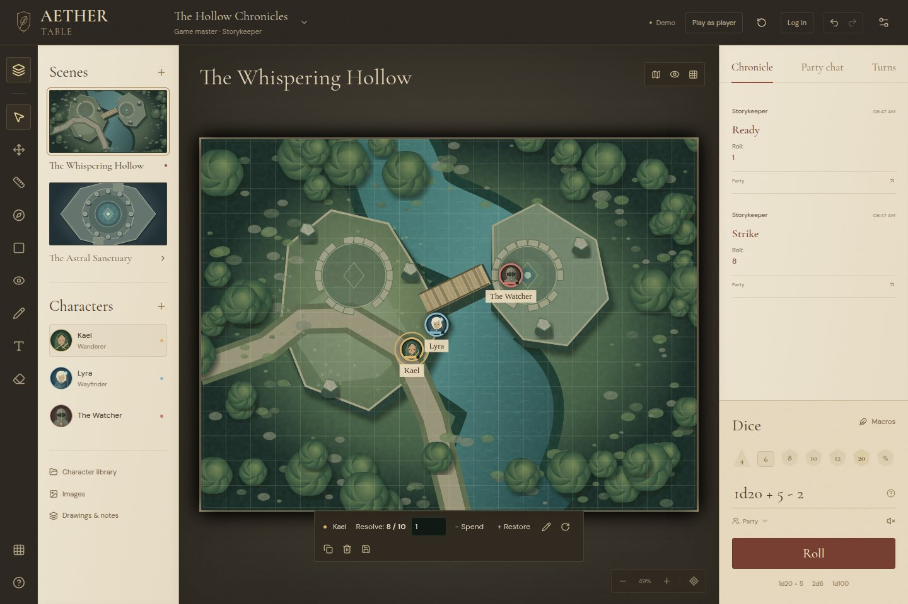
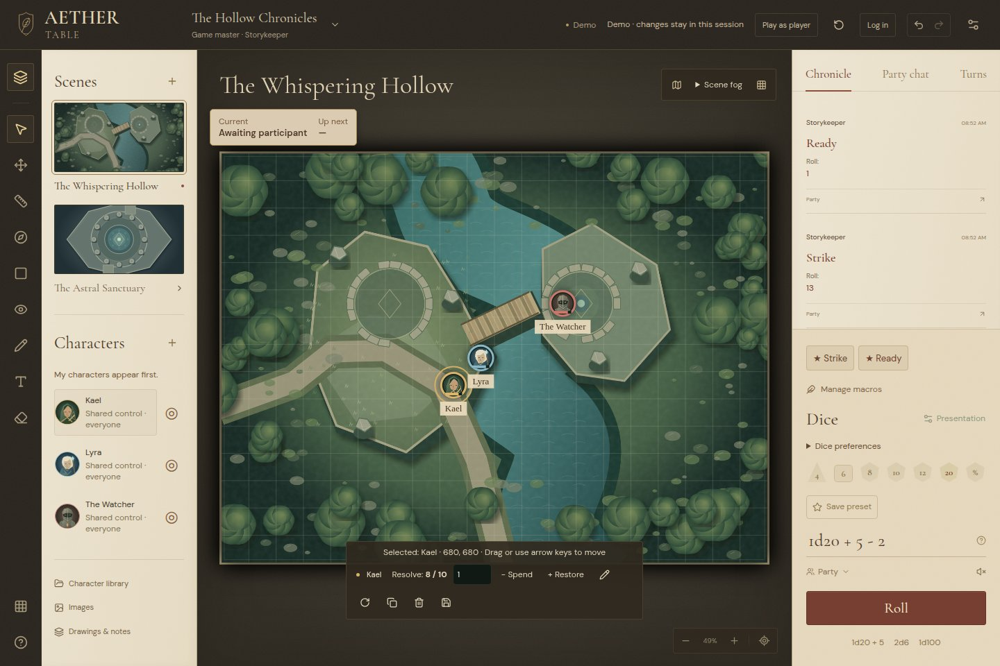
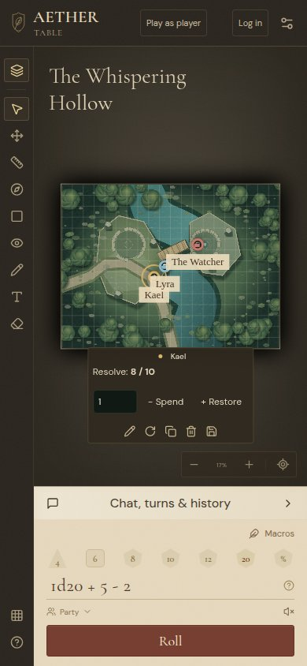
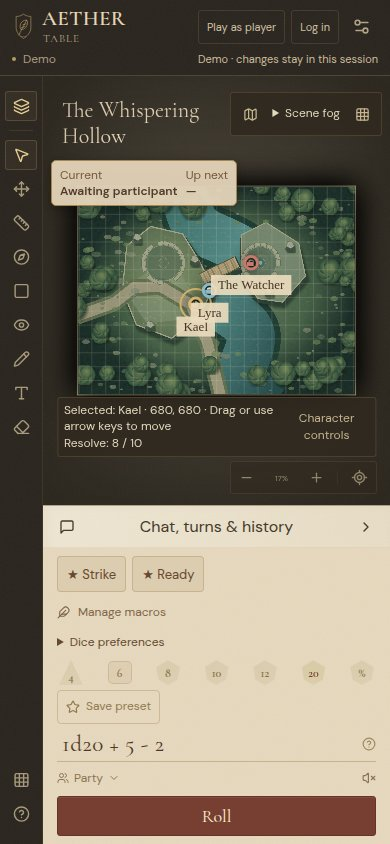
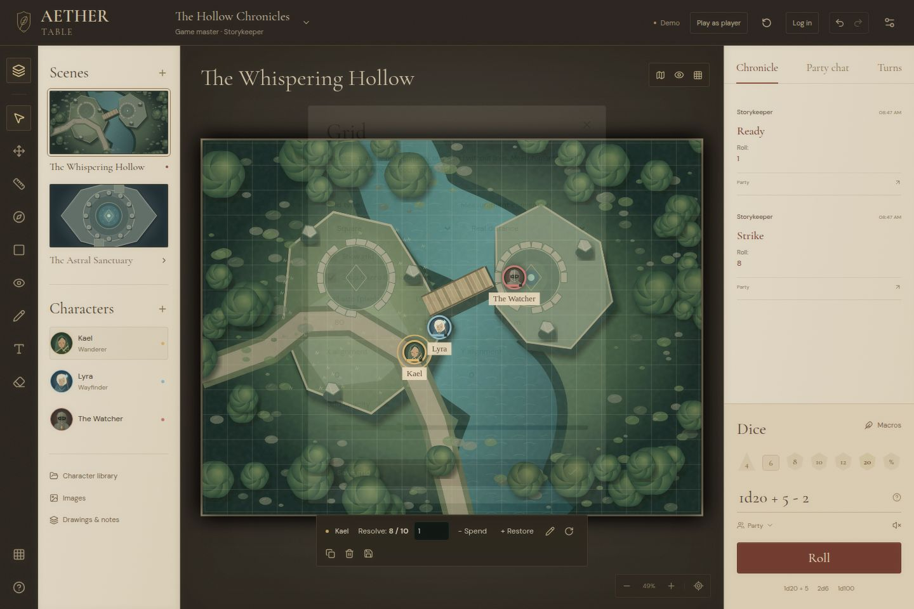
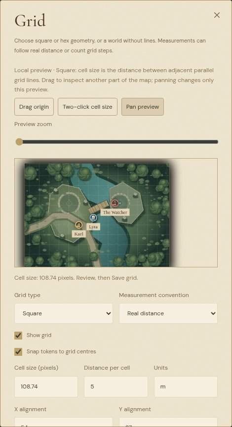

# Tabletop usability review

Reviewed baseline: `b6d3f79596dc10319e0042cb9698b48c5e0dd25a`. The remote matched that commit and had no open pull requests when work began.

## Behavior

- Favorites appear as named actions beside Dice. Actions without variables roll immediately; other actions prompt inline and remember numeric inputs. Manage macros retains editing/importing and Favorites/Recent. Private definitions default to private results in the strip. Changed or removed definitions invalidate open prompts.
- Assigned and shared characters appear first, with explicit control labels and Center controls. The compact library also lists scene characters. An empty assignment message and a dismissible, role-aware introduction explain finding, moving and rolling. Dismissal and dice preferences remain local.
- Current / Up next stays on the tabletop. Tracker editing preserves `tokenId`; selected tokens can be linked individually or added together after reviewing visibility. Your turn follows control ownership. Focus controls use visible tokens. Server projections omit entries linked to hidden or fog-covered tokens and omit successor hints when the immediate successor is hidden; fog, visibility changes and undo update those projections.
- Grid settings include an isolated map preview, origin dragging, two-click calibration, preview zoom and panning. Square calibration uses adjacent intersections; pointy-top hex calibration uses neighbouring centres in a horizontal row. Numeric inputs remain available. Preview/cancel sends nothing; each Save sends one `GRID_UPDATE`. Pending saves lock all controls and rejected saves retain the draft.
- Campaign images reuses projected asset metadata and existing scene/template references. Thumbnails load in pages of twelve and use the existing asset cache. Upload and URL remain available; choosing an existing image sends its reference without another upload.
- Save preset remains visible. Dice presentation preferences sit beside the controls. Arrow keys move selected controllable tokens by a grid cell, a neighbouring hex centre, or ten map pixels when snapping is off. Inputs, dialogs and other interactive controls retain their keys. The selected token has a textual position/control status; phones can expand Character controls for resources and GM actions.
- Live connection state and durable save state are separate. Last saved follows successful `SAVED` events and authoritative reconnect snapshots. Revision comparisons, outstanding actions and the existing server dirty flag prevent newer changes from being described as saved, including configuration edits sharing a gameplay revision. Reconnect guidance asks users to wait and inspect unconfirmed actions.
- Scene fog has separate Reveal entire scene and Cover entire scene actions. Both confirm the visibility/geometry consequences; normal brush operations remain immediate and undoable. The controls explain that fog conceals visually and does not make the shared map image confidential.

## Macro guard compatibility

Replacement requests carry a SHA-256 digest of the reviewed ID, name, source, owner and visibility. The server recomputes it before preparing any import changes. Gameplay revision and legacy `version` fields no longer authorize replacement. Existing snapshots need no rewrite: content determines the guard, and undo restores the matching content. Revision-only replacement frames fail closed; old open clients need the updated frontend before replacing macros against the updated server. The existing 256 KiB UTF-8 frame limit remains enforced.

The regression restores an older snapshot after an edit, makes a different edit at the reused revision, then submits the surviving stale preview. It checks atomic rejection and content restoration through undo. Hash tests compare Unicode, padding boundaries and long inputs with Node's SHA-256; socket tests replace a full library while keeping requests compact.

## Verification

- 363 unit/server tests pass, including real local HTTP/WebSocket authorization, snapshot rollback, linked tracker and asset projections, undo, and saves with newer configuration changes.
- Typechecking and the production frontend/server build pass with the GitHub Pages repository subpath. Vite reports the existing large dice-engine chunk warning.
- All 64 browser scenarios pass across the nine suites, each run with a fresh local backend. The `usability` browser suite is included explicitly in the CI matrix. It covers GM/player roles at desktop and 390 px widths, keyboard exclusions, remembered/favorite/deleted actions, rejected actions, local grid cancellation and update counts, fog confirmations, independent player/GM asset and tracker projections, authorization, reconnects and save status.
- Production static-demo smoke testing passes with cloud requests blocked. The existing mocked hosted-entry check passes; it tests compiled frontend service boundaries.
- Before/after captures were inspected for desktop, phone and grid settings. Chromium runs used the installed Playwright Chromium build (`chromium-1243`) through the repository's existing environment override.

The PostgreSQL migration/concurrent-writer check could not run locally: this environment has no PostgreSQL tools or disposable database. Its existing CI job remains enabled. Live Render/Supabase multiplayer remains unverified; local sockets and mocked hosted login do not establish hosted operation. No infrastructure, credentials, permissions or production settings changed, and nothing was merged or deployed.

## Screenshots

These are independent captures with example rolls. Before images use the reviewed baseline; after images use this implementation.

| View          | Before                                                 | After                                                  |
| ------------- | ------------------------------------------------------ | ------------------------------------------------------ |
| Desktop       |  |    |
| Phone         |      |        |
| Grid settings |        |  |
