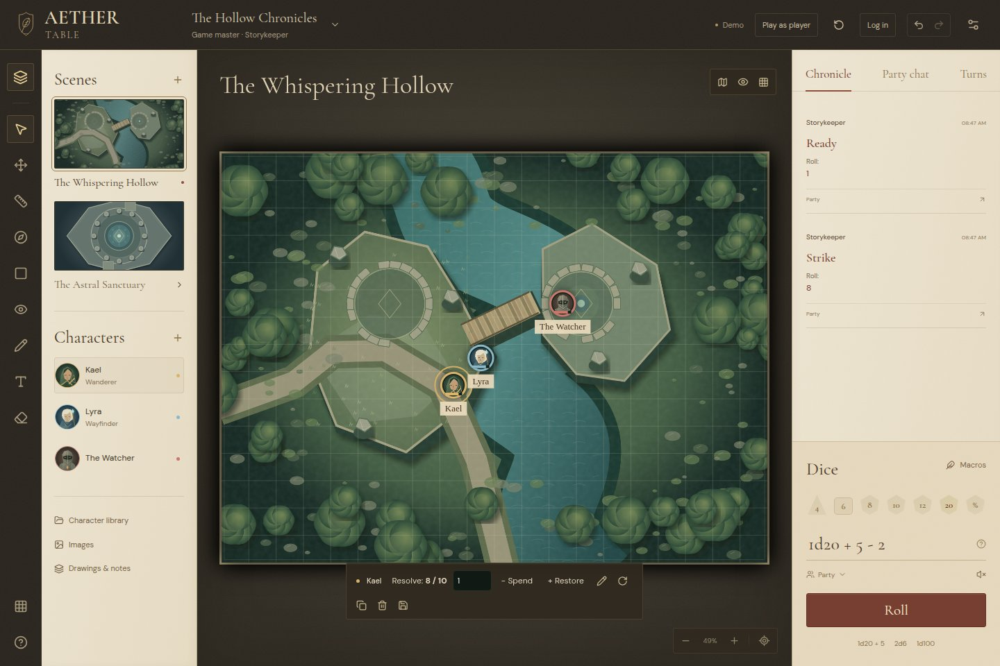
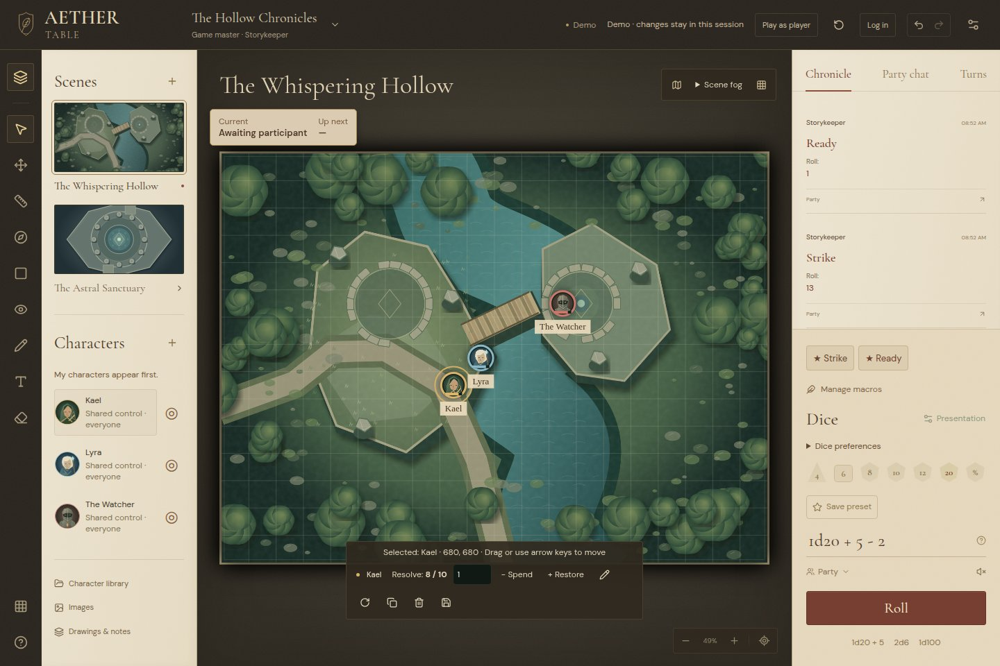
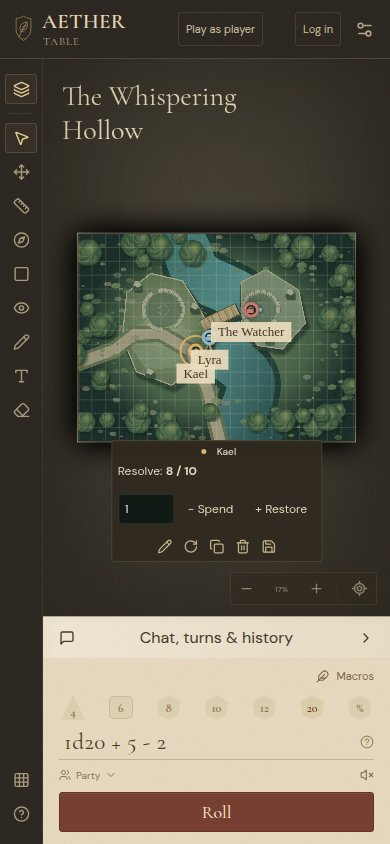
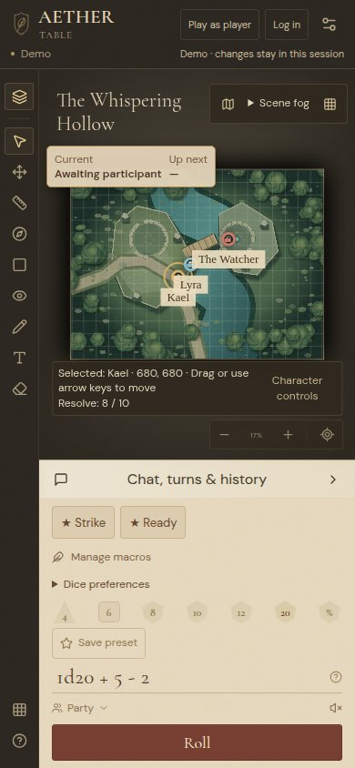
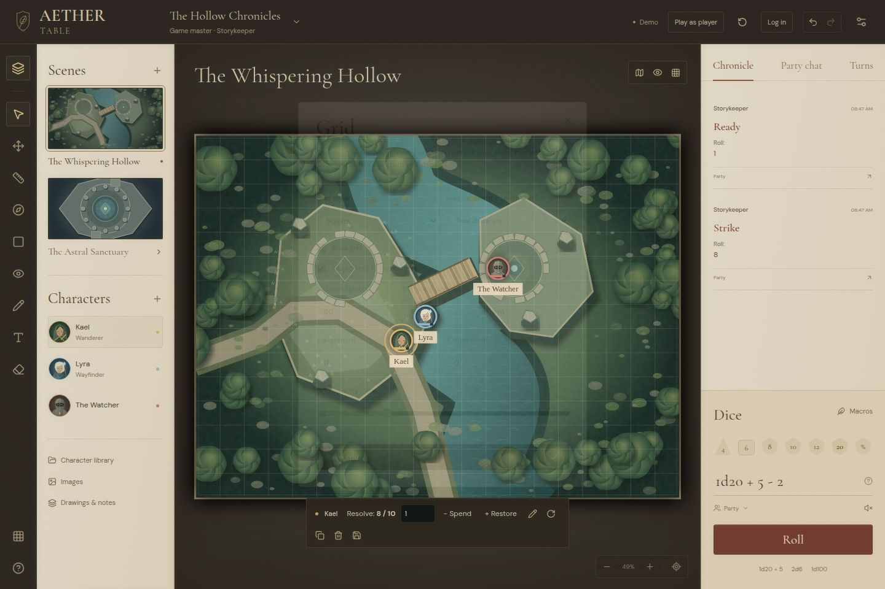
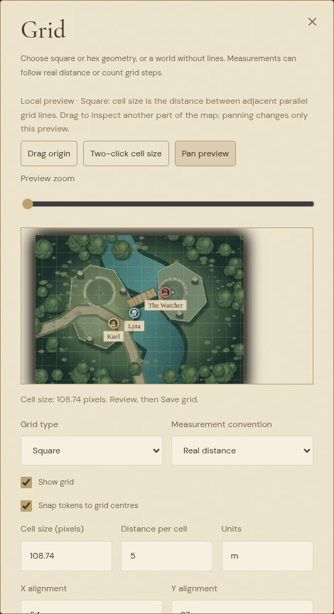

# Tabletop usability review

## Laptop desktop UI critique — 24 October 2026

The desktop workspace still spends too much laptop space on navigation and setup. Its main weakness is vertical priority: opening Dice or a character sheet can put the action needed to play below the viewport. A clean map with both panels closed conceals these problems.

Reviewed 33 new screenshots: map, library, dice, sheet, editors and focus states at 1280 × 720, 1366 × 680, 1440 × 780 and a narrower 1093 × 600 window, plus the 1199/1200-pixel panel breakpoint. These are browser content dimensions; the shorter and narrower windows represent the space available with browser chrome, windowing or Discord alongside. Captures produced no JavaScript errors. The findings below are recommendations for the next implementation pass.

| Priority                               | Evidence and critique                                                                                                                                                                                                                                                                                                                                                                                                                                                    | Recommended correction                                                                                                                                                                                                                                                                  |
| -------------------------------------- | ------------------------------------------------------------------------------------------------------------------------------------------------------------------------------------------------------------------------------------------------------------------------------------------------------------------------------------------------------------------------------------------------------------------------------------------------------------------------ | --------------------------------------------------------------------------------------------------------------------------------------------------------------------------------------------------------------------------------------------------------------------------------------- |
| **1 · Primary dice action**            | [1366 × 680 Dice](images/laptop-review/1366x680-both-dice.jpg): Roll starts at y≈674, leaving only its top six pixels visible. Empty history alone reserves 100 pixels; macro guidance and preferences precede the expression and action. At 1280 × 720 the button is still partly clipped. The panel fits horizontally while its main task requires scrolling.                                                                                                          | Keep expression, visibility and Roll in a persistent composer. Place history and macro guidance in the remaining scroll area, collapse empty history, and put presets/preferences behind secondary controls. Reuse the token editor's persistent-action pattern.                        |
| **2 · Character action access**        | [1366 × 680 sheet](images/laptop-review/1366x680-sheet-only.jpg): the first sample Use button begins at y≈830. It is also below a 1440 × 780 viewport. Panel chrome, character selection, ownership, navigation, resources, recovery, search and result visibility all precede the first action. Abilities navigation offers a workaround but adds a step each time the sheet opens.                                                                                     | Open with playable abilities. Keep identity and resource totals in a compact summary; move recovery and detailed resource adjustment below actions or into an explicit resource view. Preserve ability costs beside their Use controls. Apply this to desktop panels as well as phones. |
| **3 · Panel budget and breakpoint**    | [1280 × 720 with both panels](images/laptop-review/1280x720-both-sheet.jpg): 56 + 248 + 360 pixels of rail/panels leave only **616 pixels** of map. The same Library → Dice sequence yields a **783-pixel map at 1199 pixels** ([capture](images/laptop-review/1199x680-breakpoint.jpg)) and a **536-pixel map at 1200 pixels** ([capture](images/laptop-review/1200x680-breakpoint.jpg)). One extra pixel of window width therefore allows a much worse working layout. | Coordinate panels using the remaining canvas budget, with one side panel by default on laptop widths and an explicit option to pin both. Keep scene browsing transient during play. Consider adjustable panel widths only after fixing the default allocation.                          |
| **4 · Trackpad navigation**            | The [wheel handler](../src/components/Tabletop.tsx) treats vertical wheel motion as zoom and ignores horizontal deltas. In a simulated browser wheel check, a vertical delta of 160 changed zoom from **46% to 36%**; horizontal scrolling left the camera unchanged. Panning requires Space-drag, the Pan tool or a middle button. This makes map travel indirect on a laptop and makes scroll gestures change scale.                                                   | Give trackpads two-finger panning and pinch-to-zoom, with a clear mouse-wheel preference. Retain Space-drag and existing shortcuts. Verify the resulting interaction on physical Windows and Mac trackpads; simulated wheel events do not establish hardware usability.                 |
| **5 · Toolbar height**                 | [1366 × 680 map](images/laptop-review/1366x680-map.jpg): the rail needs 734 pixels inside a 620-pixel region. Erase is partly visible; Grid and Guide are below the initial view. Even at 1440 × 780, Guide is partly clipped. Eleven-pixel captions and similar treatment across navigation and authoring tools make the rail difficult to scan.                                                                                                                        | Keep Library, Sheet, Dice and Turns immediately available. Group less frequent authoring tools into a labelled menu, retain shortcuts, and make overflow discoverable. Use height-aware spacing before requiring a separately scrolling rail.                                           |
| **6 · Narrow laptop / Discord window** | [1093 × 600](images/laptop-review/1093x600-both-dice.jpg): the header wraps from 60 to 97.5 pixels, consuming about 16% of viewport height. The right panel's header and tabs consume another 103 pixels. The expression and Roll are offscreen. A narrower window compounds the height problem.                                                                                                                                                                         | Keep a single compact header by reducing branding/subtitles and moving secondary controls into a menu. Add viewport-height rules; adapting only to width misses the core laptop constraint.                                                                                             |
| **7 · Preferences and focus mode**     | [Preferences at 1366 × 680](images/laptop-review/1366x680-settings.jpg) opens a long, dense form with its Done action below the viewport. Focus mode frees the map but removes access to Sheet, Dice and Turns until the interface is restored. These modes impose repeated scrolling or switching during a session.                                                                                                                                                     | Give preferences clear sections and a persistent Done control. Offer a minimal play strip in focus mode, or reliable direct shortcuts for the three main activities. Keep setup controls secondary.                                                                                     |

Recommended order: fix persistent Roll and action-first sheets, correct the canvas budget, then handle trackpads and short-window navigation. Laptop acceptance checks should assert that primary actions are fully visible on first opening at 1366 × 680 and 1280 × 720, and inspect internal scroll regions rather than checking only outer viewport overflow. Include a narrow-window case for Discord alongside and both sides of the panel breakpoint.

## Screenshot critique — 24 October 2026

Captured 75 baseline screens across six viewports before this pass. Viewport fit alone missed the following usability problems:

| Evidence                                                          | Critique                                                                                                                                                                  | Planned correction                                                                                                                                                              |
| ----------------------------------------------------------------- | ------------------------------------------------------------------------------------------------------------------------------------------------------------------------- | ------------------------------------------------------------------------------------------------------------------------------------------------------------------------------- |
| [Phone map before](images/ux-review/before-mobile-map.jpg)        | The map is only about 280 × 210 pixels in a tall workspace. Tokens and their labels collide. The collapsed welcome card still occupies a substantial rectangle.           | Start compact scenes around their visible tokens, retain an explicit whole-map view, add a token-framing action, and reduce the collapsed guide to a small quick-start control. |
| [Tablet panels before](images/ux-review/before-tablet-panels.jpg) | Two side panels leave a narrow strip of map. The scene title, fog menu and guide compete inside it.                                                                       | Coordinate side panels on medium-width screens so opening one closes the other.                                                                                                 |
| [Phone sheet before](images/ux-review/before-mobile-sheet.jpg)    | Character choice, a repeated name, notes and recovery explanations fill most of the first screen. The first Use button is below the fold.                                 | Compress the sheet overview and add direct Abilities / Resources navigation; keep recovery behavior and ownership explicit.                                                     |
| [Token editor before](images/ux-review/before-token-editor.jpg)   | The dialog is called Character despite editing a scene token. Image setup precedes its name and control permissions, and saving requires scrolling through the long form. | Name the editor Token, place identity and control first, and keep the save action visible while fields scroll.                                                                  |
| [Compact dice before](images/ux-review/before-compact-dice.jpg)   | The Chronicle tab does not clearly describe the dice workspace. A small X is the only route back to the map.                                                              | Label the workspace Dice & history, give the drawer an explicit Back to map control, and support focus entry, keyboard containment and focus return on compact screens.         |

The first after capture still left part of the first Use button below the phone viewport and measured a 50-pixel quick-start control. A second iteration moved each ability's cost and action before its longer description and removed inherited button padding from the collapsed guide. The resulting acceptance checks pass without weakening the viewport assertions.

| Comparison                                                                                                         | Result                                                                                                                                                                                                                                                                                                                                                       |
| ------------------------------------------------------------------------------------------------------------------ | ------------------------------------------------------------------------------------------------------------------------------------------------------------------------------------------------------------------------------------------------------------------------------------------------------------------------------------------------------------ |
| [Phone map before](images/ux-review/before-mobile-map.jpg) → [after](images/ux-review/after-mobile-map.jpg)        | The sample tokens grow from roughly 12 to 41 screen pixels. Compact scene entry frames only tokens already present in the client's projected scene. **Fit map to screen** still shows the full map; **Focus scene tokens** returns to the action. The guide becomes a small Quick start control and primary rail destinations gain visible labels on phones. |
| [Tablet before](images/ux-review/before-tablet-panels.jpg) → [after](images/ux-review/after-tablet-panels.jpg)     | At 1024 pixels, the map beside Dice grows from 360 to 608 pixels wide. Below 1200 pixels, opening table activity closes the library and opening the library closes activity. Existing dice inputs survive these changes.                                                                                                                                     |
| [Phone sheet before](images/ux-review/before-mobile-sheet.jpg) → [after](images/ux-review/after-mobile-sheet.jpg)  | The sample's first Use button is fully inside a 390 × 844 viewport. Costs remain before the action. Abilities / Resources links provide direct navigation; notes move below the actions and recovery retains its explicit refresh groups. Newly used abilities scroll their inline results into view without jumping to old results when reopening a sheet.  |
| [Token editor before](images/ux-review/before-token-editor.jpg) → [after](images/ux-review/after-token-editor.jpg) | Name, visibility, controller and sheet link precede appearance. The save action and rejection/reload feedback remain visible while the field body scrolls, on desktop and phone.                                                                                                                                                                             |
| [Compact dice before](images/ux-review/before-compact-dice.jpg) → [after](images/ux-review/after-compact-dice.jpg) | **Dice & history** names the workspace. **Back to map** replaces an unexplained X-only exit. Compact drawers focus the active destination, contain Tab navigation, make the covered background inert and restore the opening control on close. Nested dialogs retain their own focus handling.                                                               |

The new camera checks and six browser acceptance scenarios encode the concrete problems above. The UX suite is included in CI.

Verification: 395 unit/server tests and 65 affected browser scenarios pass, with fresh servers for each browser suite. Strict TypeScript, the production frontend/server build, cloud-blocked static-demo smoke test and mocked hosted-entry smoke test pass. Baseline and final captures each cover 75 screens across six viewport sizes; the final capture reports no viewport overflow or browser/network errors. The screenshot pairs above were inspected visually, including a second iteration on the phone sheet and guide. Formatting and diff whitespace checks pass. The existing large dice-engine bundle warning remains.

Remaining opportunities: the scene editor still uses a long form, and real touch hardware and assistive-technology testing remain outside this Chromium review. No chat feature was reintroduced.

## Discord and maximised workspace — 24 October 2026

The tabletop now owns the available workspace on entry. The library and table activity start closed; a slimmer header and 56-pixel desktop / 44-pixel phone tool rail leave more room for the map. Library, character sheets, dice/history and turns open only when requested. Each panel has an explicit close control, and Escape closes the active panel. Compact layouts use a drawer. The empty turn-awareness banner is omitted until the campaign has tracker entries.

Focus mode removes the header, rail and panels as well. Its map control and Escape restore the previous workspace. Resizing preserves the camera's zoom and centre. Character actions show their results inside the compact sheet drawer, while rolling generic dice closes the compact drawer so the presentation is visible on the map.

Built-in chat has been removed: no tab, composer, unread state, styles, chat action, or message patch handler remains. Existing saved chat data is retained privately inside legacy snapshots and omitted from all client projections. Old clients cannot send the removed action. Discord webhook settings and public roll delivery continue to use the existing integration.

The earlier pass's inline dice validation, exact die selection, confirmation-based roll submission, graceful preset storage fallback and modal background isolation are retained. Browser workflows now explicitly open the panels they exercise, and the session suite checks the default map area, panel opening/closing at four viewport sizes, full-viewport focus, mobile roll visibility and live acknowledgements.

Verification: all 392 unit/server tests and all 77 browser scenarios pass, including Discord settings, character resources, permissions, reconnects and actual physical dice faces. Browser suites used fresh servers. The production frontend/server build, cloud-blocked static demo and mocked hosted-entry checks pass. All 75 captured screens at six viewport sizes fit their viewports with no browser/network errors; desktop and phone layouts were also inspected visually. Formatting, strict TypeScript and diff whitespace checks pass.

## Character and session workflow review — 16 October 2026

The review covers entering a table, finding a character, manipulating scene tokens, choosing an action, consuming resources, recovering abilities, reading results, and sharing them with Discord. The previous typography pass helped legibility but left the core player workflow split across map tools, generic dice, macros and isolated token counters.

| Finding                                                                  | Impact                                                                                | Change                                                                                                                                                                              |
| ------------------------------------------------------------------------ | ------------------------------------------------------------------------------------- | ----------------------------------------------------------------------------------------------------------------------------------------------------------------------------------- |
| Characters were represented primarily as scene tokens.                   | Resource state and available actions had no persistent home across scenes.            | Campaign character sheets have a dedicated workspace, navigation cards, ownership and optional token links.                                                                         |
| Macros and counters were separate operations.                            | Players could forget to spend a slot or spend a resource without a successful action. | Ability use validates preparation, remaining uses, costs and numeric inputs before committing the resource change and result together.                                              |
| Prepared, expended and recoverable abilities were not represented.       | Maneuvers and prepared spells required external bookkeeping.                          | Named ability groups show readiness and remaining uses, with preparation controls, search, availability filters and explicit recovery groups.                                       |
| Character controls, history and dice competed for the same narrow panel. | A sheet would leave little room for its actions.                                      | Character is a separate activity workspace; its panel uses the full available height instead of sharing it with the dice workbench.                                                 |
| Map tools relied on icon recognition.                                    | Common tools were hard to discover without hovering.                                  | Desktop tools have persistent captions and shortcuts remain available. Phone tools keep compact accessible names.                                                                   |
| GM scene/grid editing entry points appeared in player mode.              | Players encountered controls they could not save.                                     | Player mode omits grid-editing entry points and names its read-only map entry Scene details. Characters have more prominence than scene thumbnails.                                 |
| Onboarding covered the map, especially on phones.                        | Guidance blocked the space needed to play.                                            | The guide is collapsible and starts collapsed on compact layouts. It explains character abilities as well as token movement.                                                        |
| A phone drawer covered map dice presentations.                           | A character action could hide its own result and dismiss control.                     | Phone character actions report results beside the ability; explicit history replay closes the drawer to show its map presentation.                                                  |
| Sending an ability to Discord lacked character/resource context.         | Channel readers could see a roll without knowing the spent ability or remaining uses. | Public character results include their name, effect, uses and spent-pool state through the existing Discord settings. Text-only abilities can announce effects without a fake roll. |
| Text replacement could overwrite live resource use.                      | Reimporting a sheet could silently restore spent slots.                               | Replacement and deletion compare the reviewed sheet digest. Export includes current counters; stale drafts remain available for review.                                             |

The [example character](../public/examples/character.txt) is a reusable text template rather than a game-specific sheet. Its recovery tags are deliberately explicit: a table decides when Recovery, Encounter or Rest applies. Public sheets are readable by the party; only their owner and GMs can use or edit them. Resource spending, privacy projection, restart deduplication and Discord formatting run through the same shared action pipeline in live play and the offline demo.

Remaining design work: the map/scene and token editors still expose large forms; staged setup would help new GMs. Character definitions are edited through text rather than a visual ability builder, and token resource bars are separate from sheet pools. Those boundaries are visible in the UI and documentation. Broad keyboard/screen-reader auditing and full touch-device testing remain useful follow-up work beyond Chromium viewport checks.

Verification for this change: 390 unit/server tests pass, including character parsing, atomic costs, ownership and visibility, stale replacements, restart recovery, duplicate requests and Undo/Redo without another roll or Discord delivery. All 68 browser scenarios pass across suite runs. The combined run hit the existing shared-server HTTP request limit; affected suites were verified with fresh servers, matching CI. The character suite is included in the CI matrix.

The production frontend/server build passes under `/agnostic-vtt/`, as do the cloud-blocked static-demo and mocked hosted-entry checks. The visual review captures 64 screens at six viewport sizes; reviewed panels fit their viewports with no browser or network errors. Discord delivery was tested with a mocked transport; no live channel was contacted.

## Earlier implementation review

Reviewed baseline: `b6d3f79596dc10319e0042cb9698b48c5e0dd25a`. The remote matched that commit and had no open pull requests when work began.

## Behavior

- Favorites appear as named actions beside Dice. Actions without variables roll immediately; other actions prompt inline and remember numeric inputs. Manage macros retains editing/importing and Favorites/Recent. Private definitions default to private results in the strip. Changed or removed definitions invalidate open prompts.
- Assigned and shared characters appear first, with explicit control labels and Center controls. The compact library also lists scene characters. An empty assignment message and a dismissible, role-aware introduction explain finding, moving and rolling. Dismissal and dice preferences remain local.
- Current / Up next stays on the tabletop. Tracker editing preserves `tokenId`; selected tokens can be linked individually or added together after reviewing visibility. Your turn follows control ownership. Focus controls use visible tokens. Server projections omit entries linked to hidden or fog-covered tokens and omit successor hints when the immediate successor is hidden; fog, visibility changes and undo update those projections.
- Grid settings include an isolated map preview, origin dragging, two-click calibration, preview zoom and panning. Square calibration uses adjacent intersections; pointy-top hex calibration uses neighbouring centres in a horizontal row. Numeric inputs remain available. Preview/cancel sends nothing; each Save sends one `GRID_UPDATE`. Pending saves lock all controls and rejected saves retain the draft.
- Campaign images reuses projected asset metadata and existing scene/template references. Thumbnails load in pages of twelve and use the existing asset cache. Upload and URL remain available; choosing an existing image sends its reference without another upload.
- Save preset remains visible. Dice presentation preferences sit beside the controls. Arrow keys move selected controllable tokens by a grid cell, a neighbouring hex centre, or ten map pixels when snapping is off. Inputs, dialogs and other interactive controls retain their keys. The selected token has a textual position/control status; phones can expand Character controls for resources and GM actions.
- Live connection state and durable save state are separate. Last saved follows successful `SAVED` events and authoritative reconnect snapshots. Revision comparisons, outstanding actions and the existing server dirty flag prevent newer changes from being described as saved, including configuration edits sharing a gameplay revision. Reconnect guidance asks users to wait and inspect unconfirmed actions.
- Scene fog has separate Reveal entire scene and Cover entire scene actions. Both confirm the visibility/geometry consequences; normal brush operations remain immediate and undoable. The controls explain that fog conceals visually and does not make the shared map image confidential.

## Macro guard compatibility

Replacement requests carry a SHA-256 digest of the reviewed ID, name, source, owner and visibility. The server recomputes it before preparing any import changes. Gameplay revision and legacy `version` fields no longer authorize replacement. Existing snapshots need no rewrite: content determines the guard, and undo restores the matching content. Revision-only replacement frames fail closed; old open clients need the updated frontend before replacing macros against the updated server. The existing 256 KiB UTF-8 frame limit remains enforced.

The regression restores an older snapshot after an edit, makes a different edit at the reused revision, then submits the surviving stale preview. It checks atomic rejection and content restoration through undo. Hash tests compare Unicode, padding boundaries and long inputs with Node's SHA-256; socket tests replace a full library while keeping requests compact.

## Verification

- 363 unit/server tests pass, including real local HTTP/WebSocket authorization, snapshot rollback, linked tracker and asset projections, undo, and saves with newer configuration changes.
- Typechecking and the production frontend/server build pass with the GitHub Pages repository subpath. Vite reports the existing large dice-engine chunk warning.
- All 64 browser scenarios pass across the nine suites, each run with a fresh local backend. The `usability` browser suite is included explicitly in the CI matrix. It covers GM/player roles at desktop and 390 px widths, keyboard exclusions, remembered/favorite/deleted actions, rejected actions, local grid cancellation and update counts, fog confirmations, independent player/GM asset and tracker projections, authorization, reconnects and save status.
- Production static-demo smoke testing passes with cloud requests blocked. The existing mocked hosted-entry check passes; it tests compiled frontend service boundaries.
- Before/after captures were inspected for desktop, phone and grid settings. Chromium runs used the installed Playwright Chromium build (`chromium-1243`) through the repository's existing environment override.

The PostgreSQL migration/concurrent-writer check could not run locally: this environment has no PostgreSQL tools or disposable database. Its existing CI job remains enabled. Live Render/Supabase multiplayer remains unverified; local sockets and mocked hosted login do not establish hosted operation. No infrastructure, credentials, permissions or production settings changed, and nothing was merged or deployed.

## Screenshots

These are independent captures with example rolls. Before images use the reviewed baseline; after images use this implementation.

| View          | Before                                                 | After                                                  |
| ------------- | ------------------------------------------------------ | ------------------------------------------------------ |
| Desktop       |  |    |
| Phone         |      |        |
| Grid settings |        |  |
